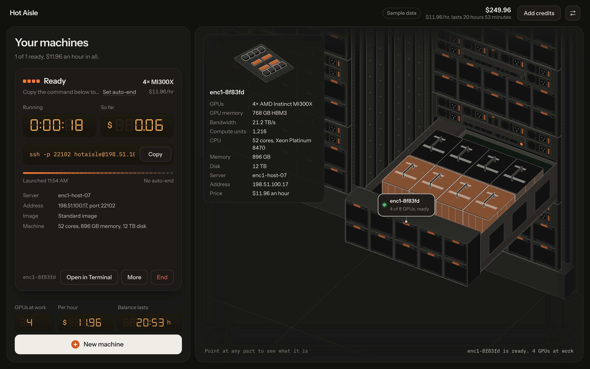
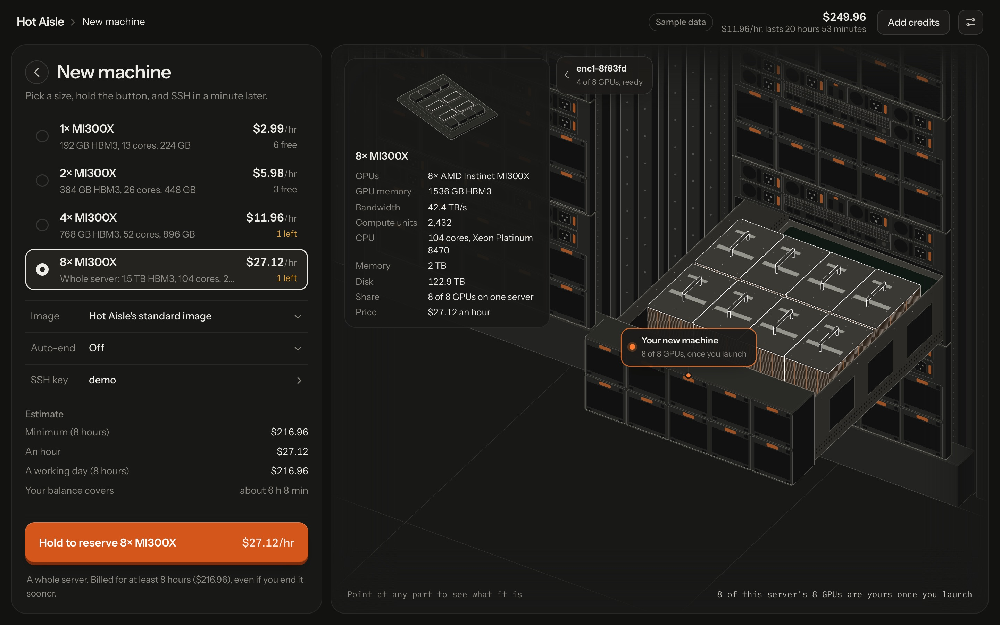

# hotaisle-ui

A web app for renting [Hot Aisle](https://hotaisle.xyz) AMD MI300X GPUs. Pick a size, hold the launch button, SSH in,
end it when you're done. Next to the controls is a live isometric drawing of the Dell XE9680 servers your GPUs are on.

Built on the public [Hot Aisle API](https://admin.hotaisle.app/api/docs/). Not affiliated with Hot Aisle.



## Try it

Download a binary from the [latest release](https://github.com/StayLameBro/hotaisle-ui/releases/latest) and run it:

```sh
# macOS, Apple silicon (also: darwin-amd64, linux-amd64, linux-arm64, windows-amd64.exe)
curl -Lo hotaisle-ui https://github.com/StayLameBro/hotaisle-ui/releases/latest/download/hotaisle-ui-darwin-arm64
chmod +x hotaisle-ui
./hotaisle-ui --demo     # sample data, nothing is billed
./hotaisle-ui            # your Hot Aisle account
```

It starts a server on `127.0.0.1` and opens your browser. To build from source (Go 1.24+, Node 20+):

```sh
git clone https://github.com/StayLameBro/hotaisle-ui && cd hotaisle-ui
make demo
```

## Features

- Virtual machines with 1, 2 or 4 MI300X, or a whole 8-GPU server as bare metal, with live availability and prices.
- Image choice: standard, Hot Aisle's vLLM template, or your own cloud-init URL.
- Auto-end after 1, 2, 4 or 8 hours, run by the local server even with the browser closed.
- Machine cards with boot progress, the SSH command (Copy, Open in Terminal), and running time and cost.
- Receipts when a machine ends, and a history of past runs that you can open and launch again.
- SSH key management: add from `~/.ssh` in one click (key comments are never uploaded), paste, or remove.
- Balance, spend per hour and time remaining; add credits through Hot Aisle's Stripe checkout.
- The drawing: your servers' GPU trays, with each GPU lit by state, every fan turning (WebGL), and labels on your
  servers. Point at any part to see what it is.
- Keyboard: `1` `2` `4` `8` pick a size, hold `L` to launch, `C` copies the newest SSH command, `Esc` goes back.
- Light and dark themes, sounds you can turn off, and reduced motion respected.
- Sample-data mode with a built-in copy of the API.



## Signing in

If you use the [Hot Aisle CLI](https://github.com/hotaisle/hotaisle-cli), you're already signed in: the app reads the
same `~/.hotaisle/config.json` (or `$HOTAISLE_CONFIG_FILE`, `$HOTAISLE_API_TOKEN`, `$HOTAISLE_DEFAULT_TEAM`).
Otherwise it asks for an API key (create one with `ssh admin.hotaisle.app`), checks it, and saves it to that file
(mode 0600).

## Security

The Hot Aisle API doesn't allow browser cross-origin requests, and an API key shouldn't be in a web page, so the
browser talks only to the local server, which adds the key and forwards to `admin.hotaisle.app/api`. The key never
reaches the page. The local server:

- listens on `127.0.0.1` only and rejects any other `Host` header (DNS rebinding);
- requires a per-launch secret, exchanged by the printed link for an `HttpOnly`, `SameSite=Strict` cookie;
- requires a custom header on every API call and refuses cross-origin requests;
- serves the page under a strict Content Security Policy.

## Hosting

`--host ADDR` serves the app to many people. Each visitor signs in with their own API key, which is kept in the
server's memory for that session only: never written to disk, never logged, never sent to the page.

```sh
docker run -p 8080:8080 ghcr.io/staylamebro/hotaisle-ui                                   # sign-in
docker run -p 8080:8080 ghcr.io/staylamebro/hotaisle-ui --demo                            # sample data only
docker run -p 8080:8080 -v hotaisle-ui:/data ghcr.io/staylamebro/hotaisle-ui --data /data # keep records
```

Without Docker: `hotaisle-ui --host :8080`. Run it behind HTTPS, as a single instance (sessions are in memory).

- Sessions use an `HttpOnly`, `SameSite=Strict` cookie, `Secure` over HTTPS. Restarting the server signs everyone
  out; Sign out in Settings forgets the key immediately.
- The host's own Hot Aisle login and `~/.ssh` are never read.
- Sample data is a separate sandbox per visitor. `--demo` makes the whole site sample data and refuses real keys.
- Machine records (launch times, auto-end timers, history) belong to the account. With `--data DIR` they're stored
  there, one file per account named by a hash of its email, without keys; otherwise in memory.
- Auto-end needs the key to end a machine, so it stays in memory while the account has a session or a pending timer.
  After a restart, a pending timer waits until its owner signs in again, and says so on the machine.

| Flag | Environment | |
| --- | --- | --- |
| `--host ADDR` | `HOTAISLE_UI_HOST` | serve on `ADDR` (`:8080`); `auto` uses `:$PORT`, or `:8080` |
| `--demo` | `HOTAISLE_UI_DEMO=1` | sample data only, real keys refused |
| `--data DIR` | `HOTAISLE_UI_DATA` | where to keep machine records (never keys) |
| `--public-host NAME` | `HOTAISLE_UI_PUBLIC_HOST` | the only host name to answer to |
| `--api URL` | `HOTAISLE_API_BASE` | API base (default `https://admin.hotaisle.app/api`) |

The Docker image runs `--host auto` as a non-root user on a distroless base; arguments after the image name are
added.

## Flags

```
--demo            start with sample data
--port N          fixed port (default: any free port)
--no-open         print the link instead of opening a browser
--config-file P   Hot Aisle CLI config file
--api URL         API base (default https://admin.hotaisle.app/api, or $HOTAISLE_API_BASE)
--static DIR      serve the front end from DIR instead of the embedded copy (development)
--host ADDR       serve many people (see Hosting)
```

## Develop

```sh
make build                      # web app + binary -> bin/hotaisle-ui
make test                       # go vet, go test, TypeScript check
make test-ui                    # layout and motion checks in headless Chrome
cd web && npm run watch         # rebuild the front end on save, then:
./bin/hotaisle-ui --demo --static web/dist
make release                    # macOS, Linux and Windows binaries in bin/
```

- `main.go`: flags and start-up.
- `internal/server`: the local server, proxy and guard; `hosted.go` is the hosted mode.
- `internal/config`: the CLI-compatible config.
- `internal/state`: launch times, auto-end timers and history (`~/.hotaisle/ui-state.json`, mode 0600).
- `internal/demo`: the sample-data API.
- `web/`: React + TypeScript front end, built with Vite and embedded with `go:embed`.
- `web/src/iso/`: the drawing. `hall.ts` builds the racks and GPU trays, `chip.ts` the MI300X close-up, `fanGL.ts`
  the WebGL fans; `Stage.tsx` animates them.
- `web/tests/stability.mjs`: runs the real binary in headless Chrome at three window sizes and fails on any layout
  shift, overflow or console error. `SHOTS=dir` saves screenshots.

See [AGENTS.md](AGENTS.md) for a guide to the code.

## Not yet tested against a real account

Everything has been run against the sample-data API, which follows the API documentation. Bare metal (reserve,
install, power, reinstall, release) and the VM web console haven't been run against a real account yet.

## Credits

Drawing kit: [Anatomy](https://github.com/wheresryan22/anatomy) by Ryan, MIT License (`web/src/iso/LICENSE-anatomy.txt`).
Hardware references: Dell PowerEdge XE9680 Technical Guide and Installation and Service Manual, Hot Aisle's compute,
pricing and data center pages, AMD's MI300X data sheet, and ServeTheHome's photographs of the MI300X OAM module.
Seven-segment digits: [DSEG](https://github.com/keshikan/DSEG) by keshikan, SIL Open Font License 1.1
(`web/src/fonts/DSEG-LICENSE.txt`). Type: Instrument Sans and IBM Plex Mono, both OFL.

## License

MIT
